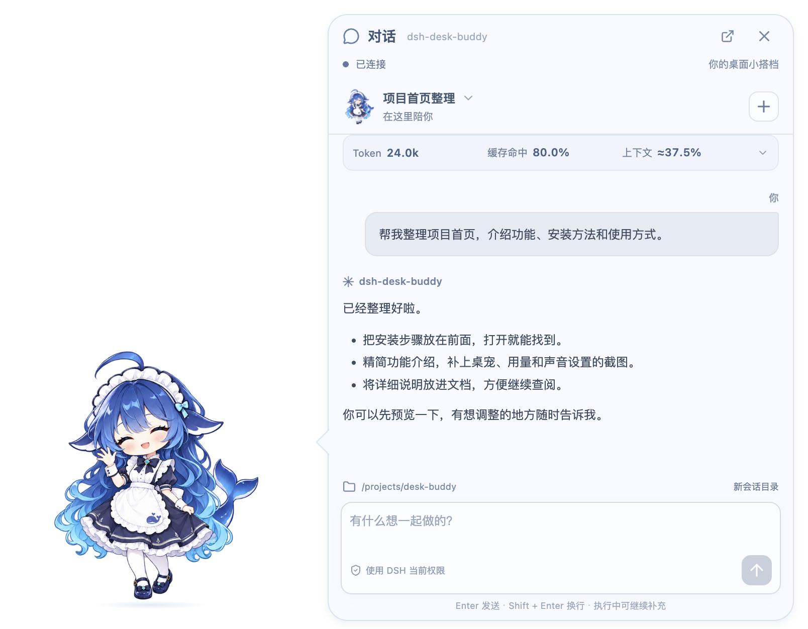
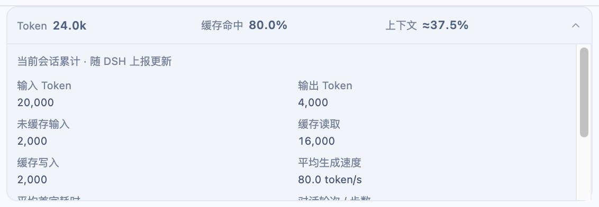
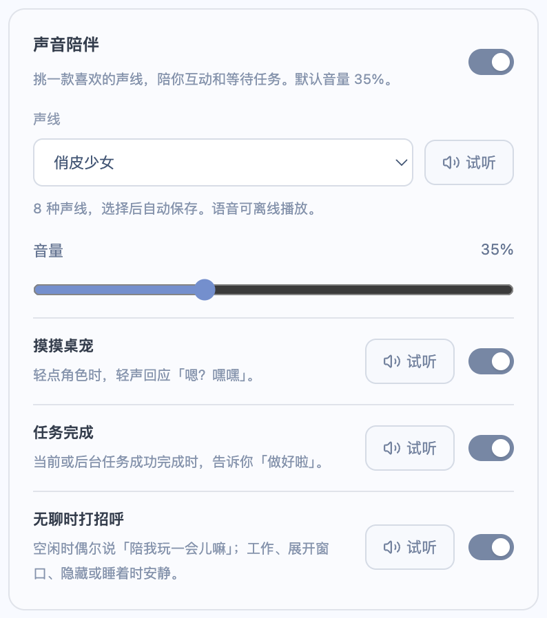

# dsh-desk-buddy

[](https://github.com/moutsea/dsh-desk-buddy/actions/workflows/desktop.yml)
[](https://github.com/moutsea/dsh-desk-buddy/releases/latest)

住在桌面上的 DSH 小搭档。陪你对话、关注任务进度，完成时轻声说一句「做好啦」。

<p align="center">
  
</p>

*截图来自实际桌宠界面；对话、用量和路径为演示数据。*

## 安装

支持 **macOS Apple Silicon** 和 **Windows x64**。

1. 打开 DSH Desktop 的 **插件 → 添加插件**。
2. 粘贴仓库地址：

   ```text
   https://github.com/moutsea/dsh-desk-buddy
   ```

3. 安装后点击 **立即启用**，重启 DSH，桌宠会自动连接。

首次启动需从 GitHub 下载约 200–230 MB 的组件，之后使用本地缓存。无需另装 Node.js、Electron 或启动 DSH Web。

也可在 [Releases](https://github.com/moutsea/dsh-desk-buddy/releases/latest) 下载对应系统的完整 `.tgz`，将附件链接或本地绝对路径填入安装框。请使用完整插件包，勿选 Source code。

已有用户在 **设置 → 插件更新** 中检查并更新。旧版本迁移、下载失败和 DSH Web 安装见 [插件安装说明](plugins/dsh-girl/README.md)。

## 她能做什么

- **桌边对话**：切换会话、发送任务、查看工具调用、处理审批和提问；支持小、中、大三档对话框。
- **任务陪伴**：19 种动态表情跟随阅读、工作和完成状态，后台任务也有进度气泡与完成提醒。
- **用量一眼看清**：当前会话累计 Token、缓存命中率和上下文占用，展开可看输入输出、生成速度和首字耗时。
- **声音由你选**：8 种离线女声，可试听、调音量，分别开关摸摸、完成和闲置招呼。
- **随手放在桌边**：拖动、缩放、置顶；悬停查看 DeepSeek 余额与峰谷倒计时。

关闭桌宠不会取消 DSH 中已接受的任务。

### 会话用量

累计统计不受历史分页影响，随 DSH 上报更新；估算的上下文占用带「≈」，未上报的数据显示「—」。

<p align="center">
  
</p>

### 声音陪伴

俏皮少女、软萌甜心、元气甜妹、清甜纯净、轻柔治愈、灵动自然、温柔邻家、轻柔气声。32 段 Qwen TTS 语音随应用打包，播放时无需联网、密钥或额外模型调用。

<p align="center">
  
</p>

## 常用操作

| 操作 | 用法 |
| --- | --- |
| 展开 / 收起对话 | `Command/Ctrl + Shift + Space`，或悬停点击「对话」 |
| 移动桌宠 | 按住角色拖动；轻点角色会回应 |
| 收起面板 | `Esc` 或右上角关闭，草稿保留 |
| 调整外观与声音 | 悬停点击「设置」；右键角色可切换表情 |
| 显示、隐藏或退出 | 系统托盘菜单，或 DSH 中的桌宠管理入口 |

## 开发

需要 Node.js 22.12+ 和可用的 DSH Web 服务：

```sh
npm ci
npm run dev
```

在设置中连接本机 DSH Web 地址，默认 `http://127.0.0.1:3080`。常用检查：

```sh
npm test
npm run build
npm run test:usage
npm run test:sound
npm run pack:plugin
```

完整操作、构建和截图更新方式见 [使用与开发指南](docs/guide.md)。

## 更多说明

[插件安装与更新](plugins/dsh-girl/README.md) · [平台支持与验证](docs/platforms.md) · [任务与表情](docs/task-behaviour.md) · [语音包](docs/voices.md) · [架构与协议](docs/architecture.md) · [更新内容](docs/release-notes.md)

接入已核对的 DSH Desktop `0.2.1-rc.2` / DSH Web `0.1.1-rc.2`。当前成品未签名，macOS 未公证；其他系统和架构的支持范围见平台文档。

功能研究参考 [dsh-whale-widget-plus](https://github.com/louke6572/dsh-whale-widget-plus)，界面与连接层由本项目实现。角色素材与生成提示词见 [角色说明](docs/character.md)。
