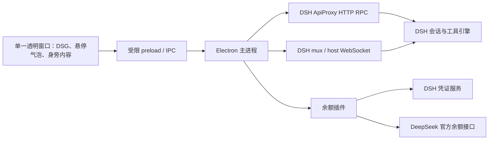

# 架构与协议

## 组成

`electron/main.mjs` 管理窗口、托盘、配置、目录选择、任务连接和广播；`electron/preload.cjs` 只公开具名操作。渲染进程不开启 Node，启用 contextIsolation 和 sandbox。`shared/dsh-client.mjs` 封装 HTTP RPC、WebSocket、重连与本机地址校验；`shared/projection.mjs` 从事件生成消息和任务文字状态；`shared/activity.mjs` 只处理实时事件，独立管理执行阶段、并行工具、短暂表情、时长与跨会话优先级。`plugins/dsh-girl-bridge` 是可单独安装的余额服务，完整 `plugins/dsh-girl` 插件则包含管理器和余额服务。

不 fork DSH，不读取其会话文件、不操作主应用 DOM，不直接运行用户输入的 shell。所有任务经 DSH 执行，权限和审批沿用宿主配置。

## 完整插件与原生组件

自 0.12.1 起，应用显示名称、仓库包名和完整插件包名统一为 `dsh-desk-buddy`。为兼容已有安装，保留原 appId、独立应用的 `DeepSeek Girl` 数据目录、插件的 `DSH_HOME/deepseek-girl/<profile-hash>/` 数据目录、内部管理路由及管道协议；更名不会重置用户设置。旧版包升级时先卸载再安装新包名。

仓库根包通过 `exports` 导出 `plugins/dsh-girl/index.mjs`，并以 `dsh.bundle.patch` 声明组合包，因此 DSH 可直接安装 GitHub 仓库地址。根包只携带插件、管理页和下载清单。首次启用没有内置 `runtime.json` 时，`release-runtime.mjs` 从 `release-runtime.json` 选择当前系统和架构的固定 Release URL，流式下载、限制大小并校验完整包 SHA-256，再只提取组件 ZIP 和清单，交给同一套原子安装流程。下载有超时，失败会清理临时文件并允许重试；缓存成功后无需联网。清单只指向本仓库已验证的 Release，不执行安装脚本或本机编译。源码插件、下载清单及内含运行时必须同版本，缓存路径也执行检查，避免静默错配。先测试候选包，用成品 SHA-256 生成清单并提交，再打标签发布同一批成品；见 `docs/releasing.md`。

`scripts/pack-plugin.mjs` 将插件后端及余额模块打包为无第三方运行依赖的 ESM，复制管理页和标准 `dsh.bundle` 声明；macOS 使用 ditto 打包同版本 `.app`，保留 framework 符号链接和可执行权限；Windows 使用系统 PowerShell 调用 .NET ZipFile 打包完整 `win-unpacked` 目录。两者都将 ZIP 和 SHA-256 清单放进带系统、架构名的插件 `.tgz`，不依赖 npm 生命周期脚本、额外运行时下载或系统 Electron。PowerShell 使用固定脚本，路径通过环境变量传入，支持空格、中文和引号。Windows 启动直接执行 `.exe`，不经过 shell、不显示控制台。

插件注入当前 `webServer`、`credentials` 服务，读取真实监听端口；管理路由限制本机地址、来源和请求体，操作白名单仅包含启动、关闭、显示、隐藏、对话和自动启动设置，不接受路径、命令或任意 RPC。Desktop 通过结构化 `webserver/index-inject` 注入自己的管理按钮，旧版 Web 使用 `tapIndex`；不会抓取或操作 DSH 会话页面 DOM。余额继续通过同源只读接口提供。

`DesktopManager` 序列化启停操作、合并重复启动，并跟踪自己创建的原生子进程。组件首次启动校验归档，再原子安装至用户缓存；成功标记的不可变组件可复用。数据位于 `DSH_HOME/deepseek-girl/<profile-hash>/`：管理偏好、运行组件与 `settings/` 分开，DSH 随机端口变化不会丢失自动启动选择。独立应用继续使用原 userData，彼此不改写配置。

插件以私有管道控制原生组件：macOS 使用 stdin/stdout，Windows GUI 程序使用每次启动随机创建的本机命名管道。只发送固定管理命令，组件仅回报 ready、连接和可见状态，不传会话文本或凭证。子进程环境过滤凭证及 Node/Electron 注入选项。插件 dispose 优先请求应用正常退出并保存配置，超时后仅终止自己持有的进程；宿主崩溃时管道 EOF 也会关闭桌宠。手动退出后不自动拉起；重启由用户管理页或下次启用决定。

原生组件通过 `electron/managed.mjs` 接收插件启动信息，锁定本机 endpoint；初次启动允许宿主 API 尚未就绪时重试连接读取，业务写操作仍不自动重试。管理页与 DSG 的样式和功能相互独立，独立启动完全保留。支持 macOS 官方 DSH Desktop 0.2.1-rc.2 与旧版 DSH Web。宿主发布 webServer 服务时不一定已经监听，插件先注册路由和启动注入，再在激活之外等待随机端口就绪，避免形成启动死锁。

### 官方 Desktop 0.2 连接

`plugins/dsh-girl/desktop-bridge.mjs` 使用 `connection.createPeer` 创建受插件生命周期管理的 owner Peer，通过 `typertGateway.invoke/stream` 调用 session list/create/prompt/cancel/follow/page。历史先读取完整 follow 开场快照；翻页固定 throughSeq，不将加载历史当作新事件。发送复用请求 ID，不重试写操作。

统计在同一个 Peer 上订阅 `session.control`，将完整 baseline 和后续 projection 转发至桌宠；流结束或失败时重连并重新接收基线。`shared/session-projections.mjs` 按指标键比较序号，区分列表中的 cached 提示与 sequenced 数据；缓存检查点不参与实时序号比较，正式快照清理已缺失的指标并保留比快照更新的值。统计能力恢复但会话序号不变时，完整快照可以补回缺失指标；同序号事件和列表提示仍不可恢复已移除的指标。断线时清空统计序号，忽略上一代连接未完成的列表和历史响应，避免宿主重启后旧数值锁住新统计。

历史请求与控制流订阅共用发起顺序，控制流在 WebSocket 握手前预留顺序，新建的会话统计存储也沿用该顺序。同一会话序号下，旧历史或迟到的控制流基线不能覆盖后来已接受的统计快照，但历史消息仍可合并。尚未返回或无效的新请求不阻止旧请求提供有效统计；更高的会话序号仍优先于请求顺序。已接受快照的会话序号与请求编号成对保存，序号前进时同步替换对应请求编号，避免较低序号的请求编号阻挡后续同序号纠正或指标移除。

较新的完整快照可以纠正同序号下已有指标的值，不必先移除指标；比快照序号更高的实时值仍保留，重复实时帧和列表提示仍按严格递增序号处理。状态广播按固定 35 毫秒窗口合并，连续事件不会延长已排定的发送时间，避免并行会话输出阻塞统计刷新或让完成提醒在送达前过期。

自动完成音绑定连接代次和原完成事件，播放前及状态更新时重新检查。切换宿主、重新连接或断线会改变连接代次，失效的待播放提醒立即释放优先级；普通会话切换不改变代次，后台完成提醒继续有效。音频缓存不随连接清空，手动试听仍独立于连接状态。

独立的随机 loopback 端口将当前 DSG 使用的 ApiProxy 消息转换成宿主服务调用；仅允许既定会话操作，每次生成 256 位随机令牌，HTTP 与 WebSocket 都要求专用请求头并拒绝浏览器 Origin。令牌仅进入所属子进程环境，不写入配置、不进入网页状态，不使用宿主 Cookie。新版宿主仍保持原有认证边界。

`$events` 在同一个 Peer 上承载审批、提问、取消、会话增删、running 和错误；人工回答通过 `$events/result` 关联 clientId/eventId，主界面处理后取消桌宠中的同一请求。持久 session/event 驱动历史和完成提醒；`agent/assistant-stream` 的实时文字单独按 attemptId/revision 累积，不伪造持久 seq，提交最终消息后清除临时回复。流断开后重新读取历史，重复和断序片段不拼接。

停用插件时先退出 DSG，再终止连接、释放订阅和 Peer。桥接不取消已接受任务。

## 窗口布局

`SessionClients` 将新连接暂存到双事件流与宿主描述都就绪后再替换旧连接；候选事件按顺序缓冲，提交时先清理旧状态再重放。失败、超时、被后续连接覆盖或手动断开都不会让迟到候选恢复连接。历史补读共用每个平台 4 个槽位，已过期的排队读取跳过，慢查询不被定时轮询反复抢占。Codex 重连使用带抖动的指数退避（上限 30 秒），成功后重置；传输握手失败自行关闭 socket，并保留 JSON-RPC 错误的 code、method、data。历史兼容优先使用标准方法不存在错误码，草稿未落盘仍保留保守文案兜底；诊断只记录方法、错误码和分支，每个分支去重，不输出上游错误内容。

宿主连续发送会话新增、删除或失效通知时，主进程用 500ms 窗口合并列表刷新，避免批量关闭会话触发成百上千次全量列表请求；移除会话时同步清理活动状态、实时回复、待回应、完成提醒、任务声音和统计缓存。主进程保留本次运行中已知的轮次标识用于回退判断，随会话移除或连接替换清理；不能仅保留最近若干轮，否则 DSH 回退到更早历史时会被误判为新任务。解码音频只缓存最近 48 个片段，避免随试听持续增长。

`shared/turn-state.mjs` 为实时事件和历史快照提取一致的轮次标识。每次连接后，会话列表为运行中或本次进程曾观察到任务的普通会话补读最近历史，包括已转为只读的会话；后续由实时事件维护标识。Codex 的订阅状态变化会推进 `followRevision`，重新加载后必须校对当前轮次，旧订阅的轮次缓存不能继续用于新任务；读取失败时不发布旧轮次，并在下次列表刷新重试，迟到的历史不能覆盖新事件。只读行的实时事件等待新列表确认，已有气泡可通过验证后的历史恢复新轮次和终态，从未观察过的旧历史不会自动生成气泡。同一轮任务重连不重新弹出，断线期间出现的新轮次恢复显示，即使重连时已经结束并卸载；活动状态关联轮次标识，并记录实时事件到达时的来源列表版本；版本未推进的缓存不能清除更晚到达的工具进度或终态。历史校对发现新轮次时清除上一轮的状态、错误详情和反应，只保留事件序号以拒绝旧事件，后续刷新不会再把旧终态带入新任务。历史校对不会触发声音或庆祝。Codex 从已加载列表发现的新会话，在卸载且历史缓存未收录时必须重新查询历史列表，不能把缓存缺失当作会话删除。历史列表以整次分页查询发起时的状态版本判断缺失是否可信：空白会话在查询期间首次落盘并卸载时，即使本轮已经查过历史，也需重新核验；额外核验最多一次，期间又出现新变化的会话先保留为只读，等待下轮确认，核验失败不删除会话。查询期间到达的卸载状态优先于旧的已加载列表和订阅响应，会话继续作为只读历史保留；迟到的读取或订阅响应不会重新激活已卸载的订阅。

`shared/progress.mjs` 从普通会话、活动状态、公开流式文字和待回应事项生成执行进度气泡，仅在内容收起、所属平台连接正常且运行状态已经确认时显示。单个平台断线或重连等待列表期间，暂时隐藏该平台的气泡并保留任务与关闭记录，其他平台的气泡继续显示。`shared/tool-presentation.mjs` 统一解析工具参数，供对话中的可展开工具摘要和活动中的命令预览复用。活动 reducer 按 callId 跟踪并行工具，结束、出错及新轮次清除过期预览。`progressBubbles` 默认为 true，通过严格布尔 IPC 保存到本机配置；气泡点击使用受限的 `openSession` 选中现有会话、打开对话并读取历史。`src/ProgressBubbles.tsx` 按会话 ID 保持卡片顺序，流式更新不重排，结束后保留。`ProgressTracker` 在主进程记录本次运行中观察到的任务和终态；列表尚未返回的新会话以及只读会话恢复期间的任务先暂存生命周期，通过来源自己的新列表版本确认普通会话后再显示；已收到实时任务事件的会话即使快速完成并卸载为只读，也会保留终态和关闭记录。其他来源刷新携带的旧缓存不会提前处理暂存记录，最新结果为子代理时则清理；从未观察到任务的只读历史不会生成气泡。删除和服务切换同样清理暂存记录。会话缓存先按事件序号去重，Codex 轮次通知也在修改运行缓存、清理流式回复之前去重，避免重复通知覆盖正确的查询结果或影响下一轮任务；列表请求期间收到的实时运行状态优先于旧快照；DSH 的 host 状态与 mux 任务事件没有跨连接顺序保证，因此 host 状态仅触发来源列表刷新，用查询结果确认当前运行状态，不直接覆盖新任务或重置关闭记录；`dismissProgress` 只隐藏指定会话的气泡，新轮次开始后恢复显示。关闭记录跨界面展开、收起和短暂重连保留，删除会话或切换其服务时清理，不写入会话历史或任务状态。`shared/progress-deck.mjs` 统一计算水平卡片向右上方 45° 错位叠放的几何位置、最多 5 张的可见集合与可放下的张数。超过 5 张时，静止状态保留首尾与当前会话，浏览时只渲染以当前会话结尾的 5 张，由方向键及 Home / End 改变选中，选中会话始终放在最前槽位；五张以内保持列表顺序。气泡区域按桌宠上方可用高度裁剪张数（至少 1 张），卡片和计数条都不会盖到角色头顶，因此贴屏幕顶部时也不影响摸摸和拖动。透明卡片和过渡中的卡片均计入 5 张上限，未显示的会话不挂载。鼠标悬停只做视觉强调：指针所在的卡片保留气泡尾部并亮出自己的关闭按钮，其他卡片仅保留 10% 不透明度并隐藏正文。悬停既不改变选中也不重排槽位，关闭按钮因此不会被指针唤起的重排挪走；键盘浏览时选中的卡片置顶，静止时按槽位层叠，每张卡片都留有自己的边条。命中区域只覆盖卡片本身，卡片之间的空隙保持桌面点击穿透；点击某张卡片即打开该会话，回车打开当前选中。可访问名称包含标题、状态和预览，绘制副本对辅助技术隐藏。会话管理页每行也提供等价的关闭按钮。气泡复用角色上方空间并限制在窗口内，不改变原生窗口边界或自动抢焦点。

`chatSize` 控制对话内容区域，`CHAT_SIZES` 定义小（默认 360 × 460）、中（480 × 620）、大（600 × 760）三档。主进程只接受这三个枚举值，旧配置或无效配置回退到小档。设置立即保存并同步窗口布局；拖动、切换入口和重启时沿用选择，并按 workArea 限制尺寸，不缩放文字或改变其他面板的目标尺寸。

只有一个透明 BrowserWindow。`shared/desktop-layout.mjs` 根据 DSG 屏幕锚点和 workArea 选择内容左右方向、宽高和角色在窗口内的偏移。收起默认 300 × 400，按 `petScale`（50–150、每档 5、默认 100）调整角色区域，对话内容默认 360 × 460，可按三档大小设置调整，其他内容最多为 460 × 720，另加间距。渲染状态 `surface` 通过受限 `section` 操作切换，原生窗口改变边界时重新计算位置，保持正常屏幕上的角色锚点；显示器变化则限制在可见区域。移动后保存的是角色区域的屏幕坐标，非展开窗口左上角。`petSize` 与 `resizedPetAnchor` 为主进程和 React 共用的尺寸规则：角色按比例变化，气泡与内容不缩放；调整前后保留水平中心与脚底，超出工作区时限制在屏幕内。设置滑块在释放后提交，避免拖动期间窗口重排带走滑块；IPC 校验范围，旧配置回退到 100%。

React 同时保留角色与内容组件，收起时隐藏并 inert，避免丢失草稿。对话标题内的会话列表为内联区域，不创建 dialog 或第二个原生窗口。鼠标移动按角色、可见气泡和内容区域启停穿透；气泡只在悬停/键盘聚焦时显示，离开有 240ms 宽限。余额随气泡显示，无常驻底栏。隐藏内容中的动画由 IntersectionObserver 暂停。原生窗口高度取角色区域与内容高度的较大值，`contentTop` 定位底部对齐的内容，确保放大后的 DSG 不被较小的对话框裁切；气泡尾部按此偏移对齐角色。

直接拖动由 `src/usePetDrag.ts` 使用 Pointer Events 与指针捕获实现，超过 5px 阈值后用屏幕坐标差移动；requestAnimationFrame 合并移动请求，松开、取消或失焦时结束并保存。主进程只接受受限的 `drag:start/move/end` 操作，校验有限数值，按鼠标所在显示器重新布局并保持角色跟手，拖动期间禁用鼠标穿透。macOS 使用 `acceptFirstMouse` 支持从其他应用直接按住角色。

拖动中的布局通过 `desktop:surface` 只广播轻量布局数据，不重复发送整个会话历史；相同布局只移动原生窗口。内容组件保留且 memo 化，拖动不会清空输入或反复渲染历史。原生标题栏仍可拖动整个展开窗口。

## 已核对的协议

依据本机 `@deepseek-ai/dsh-host-apiproxy`（随 DSH `0.1.1-rc.2` 安装）的声明与实现：

| 操作       | 路径                            | 请求要点                                             |
| ---------- | ------------------------------- | ---------------------------------------------------- |
| 探测宿主   | `POST /api/host.describe`       | 空 payload                                           |
| 会话列表   | `POST /api/session.list`        | 返回 items，含 running、cwd、projections             |
| 创建       | `POST /api/session.create`      | cwd，可选预分配 sessionId                            |
| 历史       | `POST /api/session.history`     | sessionId、maxMessages，可选 beforeSeq               |
| 模型目录   | `POST /api/session.models`      | sessionId                                            |
| 切换模型   | `POST /api/session.selectModel` | sessionId、provider、model、可选 reasoningEffort     |
| 发送       | `POST /api/session.prompt`      | sessionId、mode: queue、text content、clientTimeZone |
| 取消当前轮 | `POST /api/session.cancel`      | sessionId；不清空 DSH 排队消息                       |
| 事件流     | `WS /api/events.mux`            | 会话事件、投影、审批、问题                           |
| 宿主流     | `WS /api/events.host`           | 会话增删、running 变化、错误                         |
| 回答交互   | `POST /api/respond`             | 回显 server-request rpcId，使用 client-response 信封 |
| 余额       | `GET /dsh-girl/balance.json`    | 配套插件提供                                         |

普通请求信封 `{type:'client-request', rpcId, method, payload}`；响应 `{type:'server-response', rpcId, result:{ok,value|error}}`。HTTP 成功不代表业务成功，必须检查 result。发送等写操作不自动重试，以防重复执行。

模型目录返回当前选择、是否可路由、按供应商分组和分组失败信息。切换模型提交完整选择，DSH 保存在会话日志中，Codex 通过 `model/list` 读取目录并用 `thread/settings/update` 应用于后续回合。官方 Desktop 没有同名的 `session.models`，桥接用 `modelCatalog`、`projections` 中的 `modelSelection` 和 `selectModel` 组合出相同形状。界面的 `provider` 在新建会话时表示平台，在 `session.selectModel` 中表示模型供应商路由，`SessionClients` 不会把它当作平台字段移除。

WebSocket 文本消息是 `{type:'server-request',rpcId,method,payload}`。两个 socket 只下行，业务请求仍使用 HTTP。支持分片 UTF-8，退出时中止连接。两个流分别重连，指数退避；两条均就绪才允许发送。重连不能依赖 since（本机版本未实现），须重新读取列表和历史。待审批/提问在 mux 订阅时由宿主重放。

注意：ApiProxy 的 `toFetchHandler` 内含 SSE 编解码，但本机真实 Web 服务的 Connection 层使用 WebSocket；普通 GET 两条事件路径返回 HTTP 426，不能据内部 fetch handler 推断浏览器传输。此差异已通过真实服务联调确认。

历史按 seq 合并，旧快照不能覆盖已接收的新事件。按 append 来源显示人类对话，模型内部替换与注入不作为用户聊天重复显示。`assistant/chunk` 的 text-delta 用于即时回复；最终 `assistant/message` 替换相同步骤的临时文本。取消时终止临时回复的流式标记。新版本若只发布最终消息，则逐条展示最终回复，不能伪装逐字输出。

主进程用 `eventsRevision` 标记历史更新，广播时若版本未变化就省略 `events`，渲染端沿用上一份数组。历史投影同时依赖版本和数组引用，确保迟到的初始完整快照能在相同版本下补齐消息；时钟和流式状态更新仍可复用投影。主进程在统一的事件更新入口执行 1600 条事件的分页上限，历史查询、实时快照和实时追加达到上限后都清除 `hasMore`，避免后续快照重新显示无法使用的加载按钮；实时事件仍继续保留，回退或切换到较短历史后可依据宿主游标恢复分页。

`eventsRevision` 不用于判断审批、连接和布局的新旧。收到广播后，迟到的初始响应仅能为同一会话、同一历史版本补齐 `events`，其他字段保留广播中的值；独立布局事件也不会被初始响应覆盖。向前分页携带会话 ID 和请求 ID，主进程成功提交后在状态中发布 `historyPage` 标识。渲染端记录可见消息的标识与位置，等待期间随用户滚动、状态和实时输出更新记录，只在对应结果进入界面时恢复该消息的位置，避免把底部新增内容或浏览器已完成的滚动补偿重复计算。Codex 历史事件另带按事件类型、轮次和条目生成的稳定 ID，不受分页重新编号影响。即使累计历史没有可见消息，提交也会释放请求，允许继续加载；切换会话、断线、历史重置、失败和未提交的请求会清理旧记录。

打开会话列表、收起内容或切到其他页面时，保留最后可见的定位记录，重新显示聊天后才恢复位置；隐藏期间仍会处理会话切换、断线和历史重置，防止旧记录恢复到已替换的历史。主动加载旧页会退出自动跟随，手动滚到底部或发送消息后恢复跟随；分页等待期间的实时更新、分页提交和隐藏后恢复都遵循用户最新的跟随选择，再次上滚则继续保留阅读位置。程序滚动记录浏览器实际采用的位置，其产生的滚动事件不改变跟随选择，避免短历史分页时因位置被限制到底部而误开启跟随。切换会话重新从最新消息开始。DSH 已完成回复使用最终事件 ID，与是否加载过前面的流式分片无关，并保留分片标识作为定位别名，兼容加载前缀与回复完成同时发生的情况。定位记录保存可见字符的 Markdown 源文偏移，流式分片另带稳定标识和源文范围；补齐前缀后按同一分片重新计算字符位置。渲染端通过解析器源文位置映射格式化后的文字，并处理转义、实体和代码，不以正文全文搜索定位，因此重复段落或 Markdown 收尾不会误匹配。没有可用字符映射时回退到消息顶部定位。Codex 最终消息通过明确的 `attemptId` 保留独立流式回复的定位别名，使回复完成与分页同时到达时也能恢复到原文位置。对于最终事件未携带 `attemptId` 的 DSH，客户端按 mux 事件顺序记录当前流与最终事件的关联，并在后续历史查询中补回；关联按会话隔离，取消、轮次边界和断线会使待关联状态失效，重放事件与迟到的旧连接响应不能占用新回复的关联。

完成提醒由 `shared/completion.mjs` 从已通过活动序号检查的实时 `turn/end` 生成，按 `connectionEpoch:sessionId:seq` 去重，暂存于主进程 `state.completions`，不写入配置。切换连接或断线时清空旧提醒；即使中间状态被合并，不同连接的同名会话也不会互相吞掉完成事件。渲染端按 6 秒期限和普通会话列表过滤，合并短时间内的多个完成；独立于正在运行的状态与手动表情，因此不会被下一轮覆盖。历史接口和列表不写入提醒。动画只变换角色外层，窗口位置、点击和拖动区域不变；关闭动画及系统减少动态效果时提供静态反馈。表情切换时先保留上一张已解码的精灵继续绘制，新图解码完成后再单帧替换，因此连续切换（多个会话先后结束或改变状态时很常见）不会出现空白帧导致的闪烁。

## 连接与凭证边界

第一版只连接 `http://127.0.0.1:port` 或 `http://[::1]:port`，拒绝用户信息、路径、查询参数和非回环地址；由主进程发请求，禁止重定向。渲染进程不能通过 IPC 传任意 URL 或 RPC 方法。普通网页导航与新窗口被禁用，打开 DSH 使用固定连接地址交给系统浏览器。

配套余额插件只接受 GET，禁止缓存和跨域；仅从 `ctx.credentials.resolve('DEEPSEEK_API_KEY')` 取密钥。官方接口有超时和一次网络失败重试，服务端缓存与并发合并，不把上游原始错误或密钥返回客户端。

用户配置（地址、选中会话、窗口位置、置顶）保存于 Electron userData，不保存 Key，不替用户修改 DSH profile。执行中的审批由用户在当前会话明确点击，绝不自动批准。

## 兼容与限制

DSH 尚无独立客户端协议版本协商，版本号只是诊断信息。探测失败明确提示服务未启动、HTTP 错误或不兼容响应。只读连接探测和本地协议测试分别记录；模拟服务通过不等于真实模型执行通过。

首次支持本机已检查协议；DSH 其他版本需重新验证。普通会话及其分支可操作，子代理待确认事项提供打开 DSH 入口。不支持直接控制子代理、远程 DSH、嵌入式桌面私有 transport、多账号余额自动匹配、复杂工具卡片、附件和完整会话编辑。Wayland 的置顶、透明与窗口位置受桌面环境限制。跨平台行为尚需各平台实机检查。
